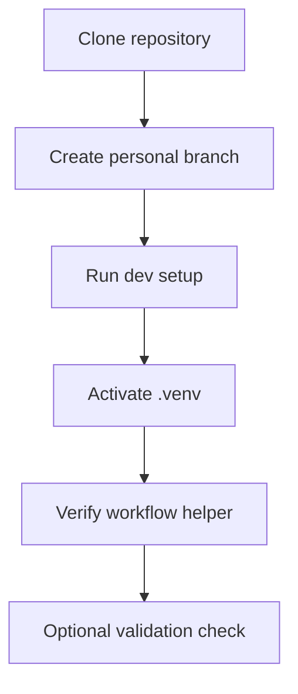
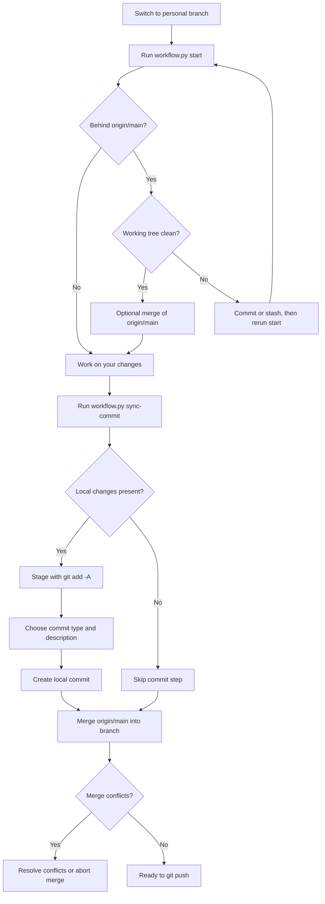
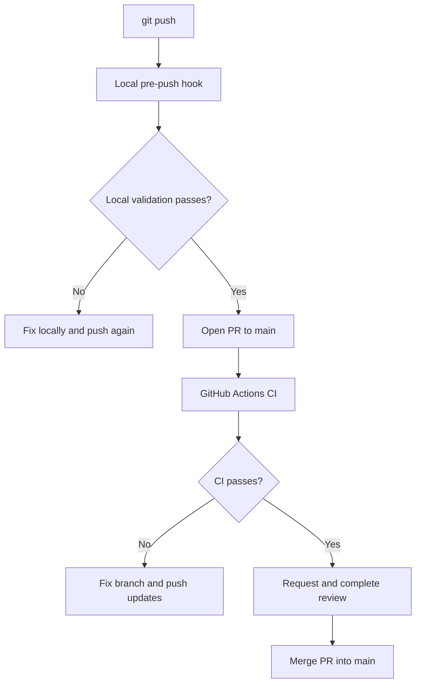

# Contributing Guide

## Workflow Summary
- `main` is protected: do not push directly to `main`.
- Each person works on their fixed personal branch (current team pattern: `*_branch`).
- Merge to `main` only through Pull Requests.
- CI must pass before merge.
- Local `git push` runs the `pre-push` checks automatically and blocks the push if validation fails.

Commands below use `python`.
If `python` is not available in your shell, use `python3` instead.

`git switch` is recommended for branch operations (clearer and safer).
If your Git version is old and does not support it, use equivalent `git checkout` commands.

## First Day Setup

1. Clone the repository:
```bash
git clone https://github.com/aferamb/prologmonio.git
cd prologmonio
```

2. Create your personal branch (one-time):
```bash
git switch -c yourname_branch
git push -u origin yourname_branch
```

3. Create/update local dev environment (venv + dependencies + hooks):
```bash
python scripts/dev_setup.py
```

4. Activate the virtual environment:

Linux/macOS:
```bash
source scripts/activate_venv.sh
```

Windows PowerShell:
```powershell
. .\scripts\activate_venv.ps1
```

5. Verify helper script:
```bash
python scripts/workflow.py --help
```

6. Optional manual validation check:
```bash
ruff check .
pytest -q
for f in *.pl; do swipl -q -s "$f" -g halt; done
swipl -q -s tests.pl -g run_tests -t halt
```

### Setup Flow



Archived draft diagram assets are stored in `docs/diagrams/contributing-workflow-draft.mmd` and `docs/diagrams/contributing-workflow-draft.png`.

## Daily Routine

### Daily Flow



### Before Working
1. Switch to your personal branch:
```bash
git switch yourname_branch
```
Fallback:
```bash
git checkout yourname_branch
```
2. Sync with latest refs and your branch upstream:
```bash
python scripts/workflow.py start
```

### Before Committing
1. Make your code changes.
2. Run:
```bash
python scripts/workflow.py sync-commit
```
3. Choose commit type and description when prompted.
4. Push manually:
```bash
git push
```
If this is the first push of that branch, use:
```bash
git push -u origin yourname_branch
```
5. The pre-push hook runs Ruff, pytest, Prolog load checks and the Prolog test suite when `swipl` is available. If any check fails, push is cancelled.

### Open Pull Request
1. Create PR from `yourname_branch` to `main`.
2. Confirm CI passes.
3. Request review.
4. Merge manually after approval.

### Pull Request Flow



## How It Works (Automation Details)

### `scripts/dev_setup.py`
What it does, in order:
1. Creates `.venv` if it does not exist (or recreates it with `--recreate`).
2. Upgrades `pip` inside that virtual environment.
3. Installs development tools from `requirements-dev.txt` (Ruff, pytest and Python analysis dependencies).
4. Creates/updates activation helpers:
```bash
scripts/activate_venv.sh
scripts/activate_venv.ps1
```
5. Creates/updates `.githooks/pre-push`.
6. Sets local Git hooks path to `.githooks` (unless `--skip-hooks`):
```bash
git config --local core.hooksPath .githooks
```

Useful options:
```bash
python scripts/dev_setup.py --recreate
python scripts/dev_setup.py --skip-hooks
```

Verify hook wiring:
```bash
git config --get core.hooksPath
```
Expected output:
```text
.githooks
```

### `.githooks/pre-push`
What it does every time you run `git push`:
1. Locates a Python interpreter (prefers `.venv` Python first).
2. Checks Ruff and pytest availability.
3. Runs Ruff:
```bash
ruff check .
```
4. Runs Python tests:
```bash
pytest -q
```
5. If `swipl` is available, checks that all top-level Prolog files load:
```bash
for f in *.pl; do swipl -q -s "$f" -g halt; done
```
6. If `tests.pl` exists and `swipl` is available, runs:
```bash
swipl -q -s tests.pl -g run_tests -t halt
```
7. If any available check fails, push is cancelled with a clear message.
8. If `swipl` is not installed locally, the hook warns and skips local Prolog checks.
9. If checks pass, push continues normally.

### `scripts/workflow.py start`
What it does:
1. `git fetch origin`
2. If current branch has upstream, performs fast-forward update only.
3. Prints summary:
```text
- current branch
- working tree clean/dirty
- ahead/behind relative to origin/main
```
4. If the current branch is not `main`, is behind `origin/main`, and the working tree is clean, it offers to merge `origin/main` before you start working.

### `scripts/workflow.py sync-commit`
What it does:
1. Refuses to run on `main`.
2. `git fetch origin`
3. If local changes exist, prompts to stage all with `git add -A`.
4. If staged changes exist, prompts for commit type + description (Conventional Commit style) and runs `git commit`.
5. Merges `origin/main` into the current branch (no rebase, no force push, `git merge --no-edit origin/main`).
6. If merge conflicts happen, stops and prints exact recovery steps.
7. Prints next push command:
```text
- git push -u origin <branch>   (first push, no upstream yet)
- git push                      (normal case, upstream already set)
```

### `git switch` vs `git checkout`
Policy used in this repo:
1. Prefer `git switch` for branch operations (clear intent and safer defaults).
2. Use `git checkout` only as compatibility fallback for older Git versions.

## Local Validation
Run locally:
```bash
ruff check .
pytest -q
for f in *.pl; do swipl -q -s "$f" -g halt; done
swipl -q -s tests.pl -g run_tests -t halt
```

These checks also run automatically on `git push` through `.githooks/pre-push`.
GitHub Actions runs the same validation set.

If validation fails:
1. Read each reported issue.
2. Fix manually in your code.
3. Run the failed command again.
4. Commit only when clean.

Note:
- Validation covers Ruff, Python unit tests, Prolog file loading and the Prolog test suite.
- No auto-formatting is enforced.
- Line length is intentionally ignored to avoid style friction.

## Golden Rules (Conflict Prevention)
- Work only on your personal branch.
- Sync before starting and before committing.
- Keep PRs small and focused.
- Never force push to shared branches.
- Do not bypass CI on `main`.

## Troubleshooting

### I have conflicts while merging `main`
1. Run `git status` and identify conflicted files.
2. Edit files and resolve conflict markers.
3. Stage resolved files:
```bash
git add <file1> <file2>
```
4. Complete merge:
```bash
git commit
```
5. Run helper again:
```bash
python scripts/workflow.py sync-commit
```
6. If needed, abort merge:
```bash
git merge --abort
```

### My branch is behind
1. Run:
```bash
python scripts/workflow.py start
```
2. If still behind `main`, run:
```bash
python scripts/workflow.py sync-commit
```

### CI fails (validation)
1. Open failed job logs in GitHub Actions.
2. Reproduce locally:
```bash
ruff check .
pytest -q
for f in *.pl; do swipl -q -s "$f" -g halt; done
swipl -q -s tests.pl -g run_tests -t halt
```
3. Fix errors, commit, and push again.

### I committed on `main` by mistake
1. Preserve work in a branch:
```bash
git switch -c yourname_branch
```
2. Push branch:
```bash
git push -u origin yourname_branch
```
3. Recreate local `main` from remote:
```bash
git switch yourname_branch
git branch -m main main_local_backup
git switch -c main --track origin/main
```

### Push rejected / non-fast-forward
1. Update local branch:
```bash
python scripts/workflow.py start
```
2. If needed, sync with `main` and recommit:
```bash
python scripts/workflow.py sync-commit
```
3. Push again (`git push` or `git push -u origin yourname_branch` for first push):
```bash
git push
```

### Push rejected because validation failed
1. Read the `pre-push` hook output.
2. Fix the reported lint, Python or Prolog issue.
3. Re-run locally:
```bash
ruff check .
pytest -q
for f in *.pl; do swipl -q -s "$f" -g halt; done
swipl -q -s tests.pl -g run_tests -t halt
```
4. Push again.

## Command Cheat-Sheet

Main commands:
```bash
python scripts/dev_setup.py
python scripts/workflow.py start
python scripts/workflow.py sync-commit
git push
```

Useful fallback commands:
```bash
git status
git branch -vv
git log --oneline --graph --decorate --all
ruff check .
pytest -q
for f in *.pl; do swipl -q -s "$f" -g halt; done
swipl -q -s tests.pl -g run_tests -t halt
```

## Maintainer Settings: Branch Protection (GitHub)
Recommended `main` protection rules:
1. Require pull request before merging.
2. Require at least 1 approval.
3. Require status checks to pass (`CI / Lint and Validate`).
4. Dismiss stale approvals when new commits are pushed.
5. Block force pushes.
6. Block branch deletion.
