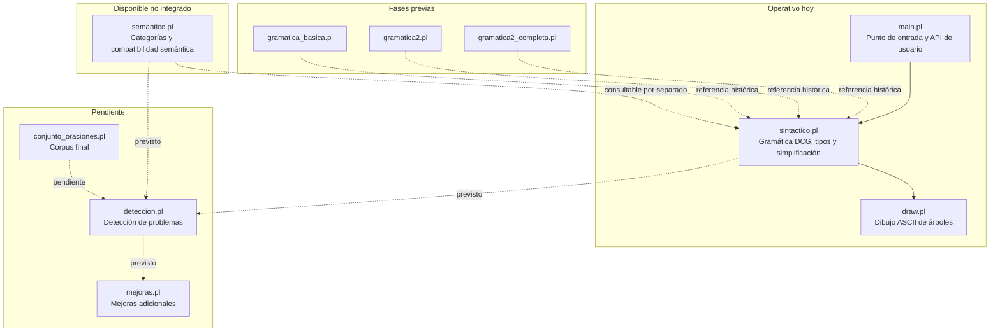
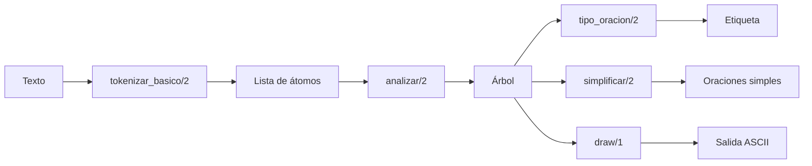
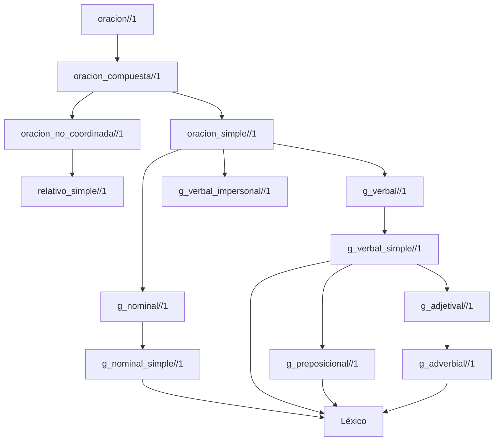
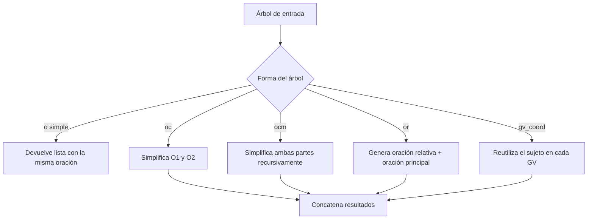

# Analizador sintáctico en Prolog

Proyecto de análisis sintáctico de oraciones en español implementado con DCG
(*Definite Clause Grammars*) en SWI-Prolog. El sistema reconoce estructuras
oracionales básicas y compuestas, construye árboles sintácticos, clasifica el
tipo de oración, puede simplificar oraciones complejas en oraciones simples y
dibuja árboles en formato ASCII.

El punto de entrada práctico es `main.pl`. La gramática principal está en
`sintactico.pl` y el dibujado de árboles está en `draw.pl`.

## Estado del proyecto

| Parte | Estado | Descripción |
| --- | --- | --- |
| `main.pl` | Operativo | API cómoda para analizar listas de tokens o texto plano. |
| `sintactico.pl` | Operativo | Gramática DCG, clasificación de oraciones y simplificación. |
| `draw.pl` | Operativo | Dibuja árboles sintácticos como diagramas ASCII. |
| `semantico.pl` | Disponible, no integrado | Base semántica consultable por separado. |
| `gramatica_basica.pl`, `gramatica2.pl`, `gramatica2_completa.pl` | Histórico / fases previas | Versiones anteriores de la gramática usadas durante la práctica. |
| `conjunto_oraciones.pl`, `deteccion.pl`, `mejoras.pl` | Pendiente | Archivos reservados para corpus, detección y mejoras futuras. |

## Requisitos

Para ejecutar el analizador solo hace falta SWI-Prolog.

| Herramienta | Obligatoria | Uso |
| --- | --- | --- |
| SWI-Prolog | Sí | Ejecutar los archivos `.pl` y lanzar consultas. |
| Python 3 | No | Scripts auxiliares de entorno, workflow y lint. |
| Ruff | No | Lint de scripts Python mediante `requirements-dev.txt`. |

Instalación orientativa de SWI-Prolog:

```bash
# Debian / Ubuntu / WSL
sudo apt update
sudo apt install swi-prolog
```

```bash
# macOS con Homebrew
brew install swi-prolog
```

En Windows se puede instalar desde el instalador oficial de SWI-Prolog.

Comprueba la instalación:

```bash
swipl --version
```

## Ejecución rápida

Desde la raíz del repositorio:

```bash
swipl -s main.pl
```

Después, dentro de la consola de Prolog:

```prolog
?- acepta([juan, analiza, el, sistema]).
true.

?- analizar([juan, analiza, el, sistema], Arbol).
Arbol = o(gn(n(juan)), gv(v(analiza), gn(det(el), n(sistema)))).

?- tipo([juan, analiza, el, sistema, y, maria, evalua, el, modelo], Tipo).
Tipo = oc.

?- simplificar_oracion([juan, come, y, bebe], Simples).
Simples = [o(gn(n(juan)), gv(v(come))), o(gn(n(juan)), gv(v(bebe)))].
```

También se puede ejecutar una consulta sin entrar en la consola interactiva:

```bash
swipl -q -s main.pl -g "analizar([juan,analiza,el,sistema], A), write(A), nl, halt."
```

## Uso con texto plano

`main.pl` incluye una tokenización básica para poder escribir frases como texto.
La tokenización convierte a minúsculas, separa por espacios, conserva las comas
como el token `','` y transforma cada palabra en átomo Prolog.

```prolog
?- tokenizar_basico("Juan, que analiza el sistema, presenta el resultado", L).
L = [juan, ',', que, analiza, el, sistema, ',', presenta, el, resultado].

?- analizar_texto("Juan analiza el sistema", Arbol).
Arbol = o(gn(n(juan)), gv(v(analiza), gn(det(el), n(sistema)))).

?- tipo_texto("Juan analiza el sistema y Maria evalua el modelo", Tipo).
Tipo = oc.

?- simplificar_texto("Juan come y bebe", Simples).
Simples = [o(gn(n(juan)), gv(v(come))), o(gn(n(juan)), gv(v(bebe)))].
```

Limitaciones de la tokenización:

- No hace lematización.
- No normaliza tildes automáticamente.
- No realiza análisis morfológico.
- No separa toda la puntuación posible como haría un tokenizador NLP completo.
- Solo funcionarán las palabras registradas en el léxico de `sintactico.pl`.

## Arquitectura



El flujo actual no carga `semantico.pl`, `deteccion.pl`, `conjunto_oraciones.pl`
ni `mejoras.pl` desde `main.pl`. Esos módulos se deben considerar extensiones o
apartados pendientes salvo que se consulten manualmente.

## Flujo de trabajo del analizador

```mermaid
flowchart TD
    A[Entrada del usuario] --> B{Formato de entrada}
    B -->|Lista de átomos| C[analizar/2]
    B -->|Texto plano| D[tokenizar_basico/2]
    D --> C
    C --> E[phrase(oracion(Arbol), Lista)]
    E --> F[sintactico.pl<br/>Reglas DCG]
    F --> G[Árbol sintáctico]
    G --> H[tipo_oracion/2]
    G --> I[simplificar/2]
    G --> J[draw/1]
    H --> K[Tipo: o, oc, or u ocm]
    I --> L[Lista de oraciones simples]
    J --> M[Árbol ASCII]
```

Transformación de datos:



## Modelo de datos

El parser devuelve árboles Prolog. Las etiquetas principales de oración son:

| Etiqueta | Significado | Ejemplo conceptual |
| --- | --- | --- |
| `o(GN, GV)` | Oración simple con sujeto explícito | `Juan analiza el sistema` |
| `o(GV)` | Oración impersonal | `Llueve` |
| `oc(O1, Conj, O2)` | Coordinación de dos oraciones simples | `Juan analiza y María evalúa` |
| `or(GN, Rel, GV)` | Oración con relativo simplificada | `Juan, que analiza, presenta` |
| `ocm(O1, Conj, O2)` | Oración compuesta mixta o encadenada | relativa + coordinación |

Constituyentes usados en los árboles:

| Etiqueta | Significado |
| --- | --- |
| `gn(...)` | Grupo nominal |
| `gv(...)` | Grupo verbal |
| `gv_coord(...)` | Coordinación verbal con sujeto compartido |
| `gp(...)` | Grupo preposicional |
| `gadj(...)` | Grupo adjetival |
| `gadv(...)` | Grupo adverbial |
| `det(...)`, `n(...)`, `v(...)`, `vc(...)`, `vi(...)` | Determinante, nombre, verbo, copulativo, impersonal |
| `aux(...)`, `part(...)`, `adj(...)`, `adv(...)`, `p(...)` | Auxiliar, participio, adjetivo, adverbio, preposición |
| `conj(...)`, `relat(...)` | Conjunción y relativo |

Ejemplo de árbol:

```prolog
o(
  gn(n(juan)),
  gv(v(analiza), gn(det(el), n(sistema)))
)
```

Ejemplo de salida aproximada con `dibujar/1`:

```text
           o
           |
      +---------+
      gn        gv
      |         |
      n     +-------+
      |     v       gn
      |     |       |
     juan analiza +----+
                  det  n
                   |   |
                   el sistema
```

La salida exacta puede variar según el tamaño de las etiquetas y la estructura
del árbol.

## Tipos de oraciones reconocidos

| Tipo | Predicado / árbol | Ejemplo |
| --- | --- | --- |
| Simple | `o(GN, GV)` | `juan analiza el sistema` |
| Impersonal | `o(GV)` | `nunca llueve en el laboratorio` |
| Coordinada | `oc(O1, Conj, O2)` | `juan analiza el sistema y maria evalua el modelo` |
| Relativa | `or(GN, Rel, GV)` | `juan, que analiza el sistema, presenta el resultado` |
| Compuesta mixta | `ocm(O1, Conj, O2)` | relativa seguida de una coordinación |
| Coordinación verbal | `o(GN, gv_coord(...))` | `juan come y bebe` |

La clasificación se obtiene con `tipo/2` desde `main.pl` o con
`tipo_oracion/2` sobre un árbol ya calculado.

## API principal

Predicados definidos o expuestos desde `main.pl`:

| Predicado | Entrada | Salida / efecto |
| --- | --- | --- |
| `acepta(Lista)` | Lista de átomos | `true` si la oración pertenece a la gramática. |
| `analizar(Lista, Arbol)` | Lista de átomos | Devuelve el árbol sintáctico. |
| `analizar(Lista)` | Lista de átomos | Imprime el árbol sintáctico. |
| `dibujar(Lista)` | Lista de átomos | Analiza y dibuja el árbol ASCII. |
| `tipo(Lista, Tipo)` | Lista de átomos | Devuelve `o`, `oc`, `or` u `ocm`. |
| `simplificar_oracion(Lista, Simples)` | Lista de átomos | Devuelve una lista de oraciones simples. |
| `simplificar_e_imprimir(Lista)` | Lista de átomos | Imprime la simplificación. |
| `tokenizar_basico(Texto, Lista)` | String o átomo | Convierte texto plano en lista de átomos. |
| `acepta_texto(Texto)` | String o átomo | Tokeniza y comprueba aceptación. |
| `analizar_texto(Texto, Arbol)` | String o átomo | Tokeniza y devuelve árbol. |
| `analizar_texto(Texto)` | String o átomo | Tokeniza e imprime árbol. |
| `dibujar_texto(Texto)` | String o átomo | Tokeniza, analiza y dibuja árbol. |
| `tipo_texto(Texto, Tipo)` | String o átomo | Tokeniza y clasifica la oración. |
| `simplificar_texto(Texto, Simples)` | String o átomo | Tokeniza y simplifica. |
| `probar_ejemplo(N)` | Número de ejemplo | Muestra lista, árbol, tipo y simplificación. |
| `probar_todos` | Ninguna | Ejecuta todos los ejemplos definidos en `main.pl`. |

Predicados relevantes de `sintactico.pl`:

| Predicado | Uso |
| --- | --- |
| `oracion//1` | Regla DCG principal usada por `phrase/2`. |
| `gn//1`, `gv//1`, `gp//1`, `gadj//1`, `gadv//1` | Alias para analizar grupos sintácticos concretos. |
| `tipo_oracion(Arbol, Tipo)` | Clasifica un árbol ya construido. |
| `simplificar(Arbol, Simples)` | Transforma árbol complejo en oraciones simples. |
| `analiza_lista(Lista, Arbol)` | Alias directo de `phrase(oracion(Arbol), Lista)`. |

Predicados consultables en `semantico.pl`:

| Predicado | Uso |
| --- | --- |
| `tipo(Palabra, Categoria)` | Categoría semántica de un sustantivo. |
| `tipo_verbo(Verbo, TipoAccion)` | Tipo semántico de una acción verbal. |
| `compatible(TipoSujeto, TipoVerbo)` | Compatibilidad entre sujeto y acción. |
| `categoria(Palabra, Categoria)` | Consulta cómoda de categorías. |
| `es_ambiguo(Palabra)` | Comprueba si una palabra tiene varias categorías. |
| `tipos_de(Palabra, Lista)` | Recoge todas las categorías de una palabra. |
| `compatibles_sujeto_verbo(Sujeto, Verbo)` | Comprueba compatibilidad semántica directa. |
| `categoria_semantica(Palabra)` | Imprime categorías semánticas registradas. |

Para usar el módulo semántico de forma aislada:

```bash
swipl -s semantico.pl
```

```prolog
?- tipos_de(banco, Tipos).
Tipos = [institucion, objeto_fisico].

?- es_ambiguo(banco).
true.

?- compatibles_sujeto_verbo(juan, analiza).
true.
```

## Ejemplos incluidos

`main.pl` define ejemplos rápidos mediante `ejemplo/2`.

```prolog
?- probar_ejemplo(1).
Lista: [juan,analiza,el,sistema]
Arbol: o(gn(n(juan)), gv(v(analiza), gn(det(el), n(sistema))))
Tipo: o
Simplificacion: [o(gn(n(juan)), gv(v(analiza), gn(det(el), n(sistema))))]
```

Ejecutar todos:

```prolog
?- probar_todos.
```

Ejemplos cubiertos:

| N | Oración tokenizada | Objetivo |
| --- | --- | --- |
| 1 | `[juan, analiza, el, sistema]` | Oración simple transitiva. |
| 2 | `[el, algoritmo, procesa, los, datos]` | Sujeto con determinante. |
| 3 | `[el, paciente, esta, muy, estable]` | Copulativa con grupo adjetival. |
| 4 | `[juan, analiza, el, sistema, y, maria, evalua, el, modelo]` | Coordinada. |
| 5 | `[juan, ',', que, analiza, el, sistema, ',', presenta, el, resultado]` | Relativa con comas. |
| 6 | Relativa + `pero` + oración simple | Compuesta mixta. |
| 7 | `[nunca, llueve, en, el, laboratorio]` | Impersonal con adverbio y complemento. |
| 8 | `[juan, come, y, bebe]` | Coordinación verbal con sujeto compartido. |

## Gramática y léxico

La gramática se organiza en varios niveles:



El léxico está al final de `sintactico.pl` en hechos como:

```prolog
det_word(el).
nombre_word(sistema).
verbo_word(analiza).
adj_word(estable).
adv_word(muy).
prep_word(en).
conj_word(y).
rel_word(que).
```

Para aceptar nuevas palabras hay que añadirlas a la categoría correspondiente.
Si una palabra no está en el léxico, la oración no se aceptará aunque la
estructura gramatical sea correcta.

## Simplificación de oraciones

La simplificación convierte estructuras complejas en una lista de oraciones
simples.



Ejemplo:

```prolog
?- simplificar_oracion([juan, come, y, bebe], S).
S = [
  o(gn(n(juan)), gv(v(come))),
  o(gn(n(juan)), gv(v(bebe)))
].
```

## Validación y desarrollo

El núcleo Prolog se ejecuta directamente con SWI-Prolog. Los scripts Python son
solo auxiliares para desarrollo del repositorio.

Crear entorno de desarrollo:

```bash
python3 scripts/dev_setup.py
```

Activar entorno:

```bash
# Linux / macOS / WSL
source scripts/activate_venv.sh
```

```powershell
# Windows PowerShell
. .\scripts\activate_venv.ps1
```

Ejecutar lint de scripts Python:

```bash
ruff check .
```

El repositorio incluye un hook `pre-push` que ejecuta `ruff check .` y, si existe
un archivo `tests.pl` y `swipl` está instalado, ejecuta:

```bash
swipl -q -s tests.pl -g run_tests -t halt
```

La suite `tests.pl` contiene pruebas de tokenización, aceptación, clasificación
de tipos sintácticos y simplificación sobre casos representativos del corpus.
Si alguna prueba falla, el hook cancela el push local y GitHub Actions marca el
check como fallido en pull requests y en `main`.

Flujo auxiliar de ramas:

```bash
python3 scripts/workflow.py start
python3 scripts/workflow.py sync-commit
```

La guía completa de ramas, hooks, Pull Requests y CI está en
[`CONTRIBUTING.md`](CONTRIBUTING.md).

## Limitaciones conocidas

- La gramática es una aproximación práctica para la asignatura, no una gramática completa del español.
- La tokenización es básica y no resuelve morfología, tildes ni variantes flexivas no registradas.
- El análisis semántico existe como módulo separado, pero no forma parte del pipeline de `main.pl`.
- La detección de ambigüedad, incoherencia o usos metafóricos todavía no está implementada en `deteccion.pl`.
- El corpus final todavía no está definido en `conjunto_oraciones.pl`.
- Las gramáticas `gramatica_basica.pl`, `gramatica2.pl` y `gramatica2_completa.pl` no son el punto de entrada recomendado.

## Estructura del repositorio

```text
.
├── main.pl                    # Punto de entrada principal
├── sintactico.pl              # Gramática DCG, clasificación y simplificación
├── draw.pl                    # Dibujo ASCII de árboles
├── semantico.pl               # Categorías y compatibilidad semántica
├── deteccion.pl               # Pendiente: detección de problemas interpretativos
├── conjunto_oraciones.pl      # Pendiente: corpus de oraciones
├── mejoras.pl                 # Pendiente: mejoras adicionales
├── gramatica_basica.pl        # Fase previa
├── gramatica2.pl              # Fase previa con árboles
├── gramatica2_completa.pl     # Fase previa ampliada
├── scripts/
│   ├── dev_setup.py           # Entorno de desarrollo
│   ├── workflow.py            # Ayuda de workflow Git
│   ├── activate_venv.sh       # Activación en bash
│   └── activate_venv.ps1      # Activación en PowerShell
├── requirements-dev.txt       # Dependencias Python de desarrollo
└── CONTRIBUTING.md            # Guía de contribución
```

## Licencia

Este repositorio incluye un archivo [`LICENSE`](LICENSE). Consulta ese archivo
para ver los términos exactos de uso y distribución.
