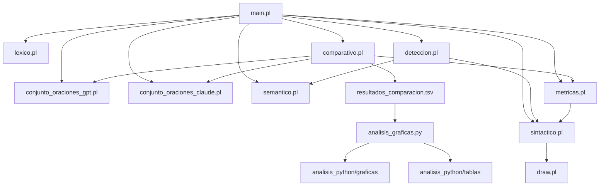

# Analizador sintactico en Prolog

Proyecto de analisis sintactico de oraciones en espanol implementado con DCG
(*Definite Clause Grammars*) en SWI-Prolog. El sistema analiza frases del
corpus GPT/Claude sobre necrobotica, construye arboles sintacticos, clasifica
el tipo de oracion, simplifica estructuras complejas, enriquece con informacion
semantica y detecta problemas de interpretacion.

El punto de entrada recomendado es `main.pl`. Desde ahi se cargan la gramatica,
el lexico, los corpus, el modulo semantico, la deteccion de problemas, las
metricas y la comparacion entre traducciones.

## Estado del proyecto

| Parte | Estado | Uso |
| --- | --- | --- |
| `main.pl` | Operativo | Punto de entrada y predicados comodos para ejecutar el analizador. |
| `sintactico.pl` | Operativo | Gramatica DCG, clasificacion y simplificacion. |
| `draw.pl` | Operativo | Dibujo ASCII de arboles sintacticos. |
| `conjunto_oraciones_gpt.pl` | Operativo | Corpus de 50 frases de la traduccion GPT. |
| `conjunto_oraciones_claude.pl` | Operativo | Corpus de 50 frases de la traduccion Claude. |
| `lexico.pl` | Operativo | Lexico comun usado por la gramatica principal. |
| `semantico.pl` | Operativo | Categorias semanticas, ambiguedad y compatibilidad sujeto-verbo. |
| `deteccion.pl` | Operativo | Deteccion de ambiguedad, incoherencia y uso no literal. |
| `metricas.pl` | Operativo | Metricas de longitud, conectores, relativos, tecnicismos y arbol. |
| `comparativo.pl` | Operativo | Comparacion GPT/Claude, resumen global y exportacion TSV. |
| `mejoras.pl` | Reservado | Archivo preparado para mejoras adicionales futuras. Las mejoras ejecutables actuales estan en `metricas.pl`, `comparativo.pl` y `analisis_graficas.py`. |

## Requisitos

Para ejecutar el analizador hace falta SWI-Prolog. Python solo es necesario para
generar tablas y graficas a partir del TSV exportado.

| Herramienta | Obligatoria | Uso |
| --- | --- | --- |
| SWI-Prolog | Si | Ejecutar `main.pl`, lanzar consultas y correr tests Prolog. |
| Python 3 | No | Generar tablas y graficas con `analisis_graficas.py`. |
| pandas, matplotlib | No | Dependencias del analisis Python. |
| Ruff | No | Lint de scripts Python durante desarrollo. |

Instalacion orientativa de SWI-Prolog:

```bash
# Debian / Ubuntu / WSL
sudo apt update
sudo apt install swi-prolog
```

```bash
# macOS con Homebrew
brew install swi-prolog
```

Comprueba la instalacion:

```bash
swipl --version
```

Si vas a generar graficas:

```bash
python3 -m pip install pandas matplotlib
```

## Ejecucion rapida

Desde la raiz del repositorio, abre una consola interactiva de Prolog:

```bash
swipl -q -s main.pl
```

Dentro de SWI-Prolog puedes ejecutar consultas como estas:

```prolog
?- probar_gpt(2).
?- probar_claude(2).
?- analizar_semanticamente_gpt(2).
?- analizar_semanticamente_claude(2).
?- comparar(2).
```

Tambien puedes ejecutar consultas directamente desde la terminal sin entrar en
la consola interactiva:

```bash
swipl -q -s main.pl -g "probar_gpt(3), halt."
```

## Ejemplos del corpus

Los corpus estan definidos en `conjunto_oraciones_gpt.pl` y
`conjunto_oraciones_claude.pl`. Algunos ejemplos utiles para probar el sistema:

| Corpus | N | Frase |
| --- | --- | --- |
| GPT | 2 | "Además, la pinza puede servir como dispositivo manual y se camufla de manera innata en entornos exteriores." |
| GPT | 3 | "Las patas de las arañas no tienen pares musculares antagonistas." |
| GPT | 11 | "En este trabajo proponemos aprovechar materiales bióticos como componentes robóticos listos para usar debido a su facilidad de obtención e implementación, centrandones en particular en el uso de una araña como ejemplo útil de pinza para aplicaciones roboticas." |
| Claude | 3 | "Las patas de las arañas no poseen pares musculares antagónicos." |
| Claude | 11 | "En este trabajo proponemos aprovechar los materiales bióticos como componentes robóticos listos para usar, dada su facilidad de obtención e implementación, centrándonos en el uso de una araña concreta como ejemplo útil de efector final para aplicaciones robóticas." |

Para recuperar el texto exacto desde Prolog:

```bash
swipl -q -s main.pl -g "oracion_gpt(3, Texto), write(Texto), nl, halt."
swipl -q -s main.pl -g "oracion_claude(3, Texto), write(Texto), nl, halt."
```

## Output del analizador sintactico

El analisis sintactico se puede ver de cuatro formas: aceptacion, arbol Prolog,
tipo de oracion y arbol ASCII.

### Salida completa de una frase del corpus

```bash
swipl -q -s main.pl -g "probar_gpt(3), halt."
```

`probar_gpt/1` y `probar_claude/1` imprimen:

- `Texto`: frase original del corpus.
- `Tokens`: lista de atomos tras `tokenizar_basico/2`.
- `Arbol`: arbol sintactico Prolog si la gramatica acepta la frase.
- `Tipo`: etiqueta sintactica principal (`o`, `oc`, `or`, `ocm`).
- `Simplificacion`: lista de oraciones simples derivadas del arbol.

Version resumida:

```bash
swipl -q -s main.pl -g "probar_gpt_rapido(3), halt."
swipl -q -s main.pl -g "probar_claude_rapido(3), halt."
```

### Arbol sintactico como termino Prolog

```bash
swipl -q -s main.pl -g "oracion_gpt(3,T), analizar_texto(T,A), write(A), nl, halt."
```

Tambien puedes usar texto libre si todas las palabras estan en el lexico:

```bash
swipl -q -s main.pl -g "analizar_texto('Las patas de las arañas no tienen pares musculares antagonistas.', A), write(A), nl, halt."
```

### Tipo de oracion

Para texto:

```bash
swipl -q -s main.pl -g "oracion_gpt(3,T), tipo_texto(T,Tipo), write(Tipo), nl, halt."
```

Para una lista de tokens:

```bash
swipl -q -s main.pl -g "tipo_lista([las,patas,de,las,arañas,no,tienen,pares,musculares,antagonistas], Tipo), write(Tipo), nl, halt."
```

### Arbol ASCII

```bash
swipl -q -s main.pl -g "oracion_gpt(3,T), dibujar_texto(T), halt."
```

En frases largas el arbol ASCII puede ser muy ancho. Para inspeccion rapida suele
ser mas legible usar `probar_gpt_rapido/1` o imprimir el termino Prolog.

### Simplificacion

```bash
swipl -q -s main.pl -g "oracion_gpt(2,T), simplificar_texto(T,S), write(S), nl, halt."
```

La salida es una lista de arboles simples. Si la oracion es coordinada o mixta,
la lista permite ver como se separan las proposiciones principales.

## Output del enriquecimiento semantico

El enriquecimiento semantico usa `semantico.pl` y se integra en las consultas de
`deteccion.pl`.

Consulta directa de categorias:

```bash
swipl -q -s main.pl -g "tipos_de(araña, Tipos), write(Tipos), nl, halt."
swipl -q -s main.pl -g "tipos_de(pinza, Tipos), write(Tipos), nl, halt."
swipl -q -s main.pl -g "(compatibles_sujeto_verbo(araña, extiende) -> write(si); write(no)), nl, halt."
```

Analisis semantico completo de una frase del corpus:

```bash
swipl -q -s main.pl -g "analizar_semanticamente_gpt(2), halt."
```

La salida de `analizar_semanticamente_gpt/1` y
`analizar_semanticamente_claude/1` muestra:

- `[AMBIGUEDAD LEXICA]`: tokens con mas de una categoria semantica.
- `Pares sujeto-verbo detectados`: pares extraidos del arbol sintactico.
- `[INCOHERENCIA SEMANTICA]`: pares sujeto-verbo incompatibles.
- `[USO NO LITERAL / METAFORICO]`: acciones propias de animados aplicadas a entidades inanimadas.
- `Clasificacion`: clase final interna (`correcta`, `ambigua`, `no_literal`, `incoherente` o `no_analizable`).

Para analizar ambos corpus completos:

```bash
swipl -q -s main.pl -g "analizar_todos_semanticamente, halt."
```

## Output de deteccion de errores

La deteccion esta en `deteccion.pl`. Clasifica problemas de interpretacion sobre
el texto y, cuando puede, usa el arbol sintactico para extraer pares
sujeto-verbo.

Clasificar una frase concreta del corpus:

```bash
swipl -q -s main.pl -g "oracion_gpt(11,T), clasificar_oracion(T,Clase,Info), write(Clase), nl, write(Info), nl, halt."
```

Ejemplos de comandos que producen cada una de las salidas posibles:

Salida `correcta`:

```bash
swipl -q -s main.pl -g "oracion_claude(1,T), clasificar_oracion(T,Clase,_), write(Clase), nl, halt."
```

```text
correcta
```

Salida `ambigua`:

```bash
swipl -q -s main.pl -g "oracion_gpt(1,T), clasificar_oracion(T,Clase,_), write(Clase), nl, halt."
```

```text
ambigua
```

Salida `no_literal`:

```bash
swipl -q -s main.pl -g "oracion_gpt(33,T), clasificar_oracion(T,Clase,_), write(Clase), nl, halt."
```

```text
no_literal
```

Salida `incoherente`:

```bash
swipl -q -s main.pl -g "oracion_gpt(7,T), clasificar_oracion(T,Clase,_), write(Clase), nl, halt."
```

```text
incoherente
```

Salida `no_analizable`:

```bash
swipl -q -s main.pl -g "oracion_gpt(11,T), clasificar_oracion(T,Clase,_), write(Clase), nl, halt."
```

```text
no_analizable
```

`clasificar_oracion/3` devuelve:

- `correcta`: no se detectan problemas semanticos.
- `ambigua`: hay palabras con varias categorias semanticas.
- `no_literal`: hay uso metaforico o no literal.
- `incoherente`: hay incompatibilidad sujeto-verbo.
- `no_analizable`: la gramatica no consigue construir arbol.

Resumen con las tres categorias del enunciado (`correcta`, `ambigua`,
`problematica`):

```bash
swipl -q -s main.pl -g "resumen_corpus, halt."
```

Ver solo las oraciones con problemas:

```bash
swipl -q -s main.pl -g "resumen_problemas, halt."
```

Si quieres comprobar por que falla una frase concreta, usa los predicados de
diagnostico de `main.pl`:

```bash
swipl -q -s main.pl -g "oracion_gpt(11,T), probar_rapido(T), halt."
swipl -q -s main.pl -g "probar_partes_basicas('materiales bioticos'), halt."
```

## Output de mejoras y comparacion

El archivo `mejoras.pl` esta reservado, pero las mejoras ejecutables del flujo
actual estan en la comparacion automatica, las metricas y las graficas.

### Comparar un par GPT/Claude

```bash
swipl -q -s main.pl -g "comparar(3), halt."
```

`comparar/1` imprime:

- Texto GPT y texto Claude del mismo numero de par.
- `Aceptada`: si la gramatica acepta cada version.
- `Tipo`: tipo sintactico detectado.
- `Longitud tokens`, `Comas`, `Conectores`, `Relativos` y `Terminos tecnicos`.
- `Oraciones simples tras simplificar`.
- `Profundidad arbol` y `Nodos arbol`.
- Comparacion final: ambas aceptadas, solo GPT, solo Claude, ninguna, mismo tipo y diferencia de longitud.

### Resumen global

```bash
swipl -q -s main.pl -g "resumen_comparativo, halt."
```

El resumen global muestra aceptacion sintactica por corpus, comparacion por
pares, medias y distribucion de tipos.

### Exportar resultados TSV

```bash
swipl -q -s main.pl -g "exportar_tsv('resultados_comparacion.tsv'), halt."
```

El TSV incluye una fila por par GPT/Claude con las metricas principales:
aceptacion, tipo, longitud, comas, conectores, relativos, tecnicismos,
simplificacion, profundidad y nodos.

### Generar tablas y graficas

```bash
python3 analisis_graficas.py resultados_comparacion.tsv
```

El script lee el TSV y genera:

- Tablas CSV en `analisis_python/tablas/`.
- Graficas PNG en `analisis_python/graficas/`.

Archivos principales:

| Ruta | Contenido |
| --- | --- |
| `analisis_python/tablas/resumen_global.csv` | Aceptacion y coincidencia global. |
| `analisis_python/tablas/medias_por_corpus.csv` | Medias de metricas por corpus. |
| `analisis_python/tablas/distribucion_tipos.csv` | Conteo de `o`, `oc`, `or`, `ocm` y `no_analizada`. |
| `analisis_python/tablas/pares_problematicos.csv` | Pares que conviene revisar manualmente. |
| `analisis_python/graficas/01_aceptacion_por_corpus.png` | Aceptadas/no aceptadas por corpus. |
| `analisis_python/graficas/02_distribucion_tipos.png` | Distribucion de tipos sintacticos. |
| `analisis_python/graficas/09_top_diferencias_nodos.png` | Pares con mayor diferencia de nodos. |

## Arquitectura



## Flujo de trabajo del analizador

```mermaid
flowchart TD
    A[Texto del corpus o texto libre] --> B[tokenizar_basico/2]
    B --> C[Tokens Prolog]
    C --> D[phrase(oracion(Arbol), Tokens)]
    D --> E[Arbol sintactico]
    E --> F[tipo_oracion/2]
    E --> G[simplificar/2]
    E --> H[draw/1]
    E --> I[extraer_pares/2]
    I --> J[semantico.pl]
    J --> K[clasificar_oracion/3]
    E --> L[analizar_resultado/2]
    L --> M[comparar/1 y resumen_comparativo/0]
```

## Modelo de datos

El parser devuelve arboles Prolog. Las etiquetas principales son:

| Etiqueta | Significado |
| --- | --- |
| `o(...)` | Oracion simple, impersonal o con complementos iniciales. |
| `oc(O1, Conj, O2)` | Coordinacion de dos oraciones. |
| `or(GN, Rel, GV)` | Oracion con relativo. |
| `ocm(...)` | Oracion compuesta mixta o encadenada. |
| `gn(...)` | Grupo nominal. |
| `gv(...)` | Grupo verbal. |
| `gv_coord(...)` | Coordinacion verbal con sujeto compartido. |
| `gp(...)` | Grupo preposicional. |
| `gadj(...)` | Grupo adjetival. |
| `gadv(...)` | Grupo adverbial. |

Tipos principales devueltos por `tipo_texto/2`, `tipo_lista/2` o
`tipo_oracion/2`:

| Tipo | Significado |
| --- | --- |
| `o` | Oracion simple. |
| `oc` | Oracion coordinada. |
| `or` | Oracion con relativo. |
| `ocm` | Oracion compuesta mixta. |
| `no_analizada` | Usado en metricas cuando no se pudo construir arbol. |

## API principal

Predicados de `main.pl` para sintaxis:

| Predicado | Uso |
| --- | --- |
| `acepta(Lista)` | Comprueba si una lista de tokens pertenece a la gramatica. |
| `analizar(Lista, Arbol)` | Devuelve el arbol sintactico de una lista de tokens. |
| `analizar(Lista)` | Imprime el arbol sintactico. |
| `dibujar(Lista)` | Analiza y dibuja el arbol ASCII. |
| `tipo_lista(Lista, Tipo)` | Clasifica una lista de tokens. |
| `simplificar_oracion(Lista, Simples)` | Devuelve oraciones simples derivadas. |
| `tokenizar_basico(Texto, Lista)` | Convierte texto en lista de atomos. |
| `acepta_texto(Texto)` | Tokeniza y comprueba aceptacion. |
| `analizar_texto(Texto, Arbol)` | Tokeniza y devuelve arbol. |
| `dibujar_texto(Texto)` | Tokeniza, analiza y dibuja arbol ASCII. |
| `tipo_texto(Texto, Tipo)` | Tokeniza y clasifica. |
| `simplificar_texto(Texto, Simples)` | Tokeniza y simplifica. |
| `probar_gpt(N)` / `probar_claude(N)` | Muestra texto, tokens, arbol, tipo y simplificacion. |
| `probar_gpt_rapido(N)` / `probar_claude_rapido(N)` | Muestra tokens, aceptacion, tipo y arbol. |
| `probar_todos` | Recorre ambos corpus. |

Predicados de semantica y deteccion:

| Predicado | Uso |
| --- | --- |
| `tipos_de(Palabra, Tipos)` | Lista categorias semanticas. |
| `es_ambiguo(Palabra)` | Comprueba si una palabra tiene varias categorias. |
| `compatibles_sujeto_verbo(Sujeto, Verbo)` | Comprueba compatibilidad semantica directa. |
| `analizar_semanticamente(Texto)` | Imprime analisis semantico completo. |
| `analizar_semanticamente_gpt(N)` / `analizar_semanticamente_claude(N)` | Analiza una frase del corpus. |
| `clasificar_oracion(Texto, Clase, Info)` | Devuelve clase interna e informacion. |
| `clasificar_oracion_enunciado(Texto, Clase)` | Agrupa en `correcta`, `ambigua` o `problematica`. |
| `resumen_corpus` | Clasifica ambos corpus. |
| `resumen_problemas` | Imprime solo frases con problemas. |

Predicados de metricas y comparacion:

| Predicado | Uso |
| --- | --- |
| `analizar_resultado(Texto, Resultado)` | Calcula aceptacion, tipo y metricas de una frase. |
| `comparar(N)` | Compara el par GPT/Claude numero `N`. |
| `comparar_todos` | Compara todos los pares. |
| `resumen_comparativo` | Muestra resumen global de metricas. |
| `exportar_tsv(Archivo)` | Exporta resultados para analisis Python. |

## Tokenizacion y lexico

`tokenizar_basico/2` convierte a minusculas, normaliza vocales acentuadas,
mantiene la `ñ`, conserva comas como token `','` y no rompe comas decimales
como `0,35`.

Ejemplo:

```bash
swipl -q -s main.pl -g "tokenizar_basico('Presion, arana 0,35 mN.', T), write(T), nl, halt."
```

Limitaciones:

- No hace lematizacion.
- No realiza analisis morfologico.
- No separa toda la puntuacion posible.
- Solo se aceptan palabras y formas registradas en el lexico cargado.

## Validacion y desarrollo

Ejecutar tests Prolog:

```bash
swipl -q -s tests.pl -g run_tests -t halt
```

Crear entorno de desarrollo:

```bash
python3 scripts/dev_setup.py
```

Activar entorno:

```bash
# Linux / macOS / WSL
source scripts/activate_venv.sh
```

```powershell
# Windows PowerShell
. .\scripts\activate_venv.ps1
```

Ejecutar lint de scripts Python:

```bash
ruff check .
```

La guia completa de ramas, hooks, Pull Requests y CI esta en
[`CONTRIBUTING.md`](CONTRIBUTING.md).

## Limitaciones conocidas

- La gramatica es una aproximacion practica para la asignatura, no una gramatica completa del espanol.
- Algunas frases aceptadas pueden tener un arbol parcialmente correcto pero no identico a un analisis linguistico manual.
- La tokenizacion no resuelve morfologia ni variantes flexivas no registradas.
- El analisis semantico depende de las categorias declaradas en `semantico.pl`.
- `mejoras.pl` no contiene aun predicados ejecutables; las mejoras actuales se consultan mediante comparacion, metricas y graficas.

## Estructura del repositorio

```text
.
├── main.pl                         # Punto de entrada principal
├── sintactico.pl                   # Gramatica DCG, clasificacion y simplificacion
├── draw.pl                         # Dibujo ASCII de arboles
├── lexico.pl                       # Lexico comun
├── semantico.pl                    # Categorias y compatibilidad semantica
├── deteccion.pl                    # Ambiguedad, incoherencia y uso no literal
├── metricas.pl                     # Metricas automaticas
├── comparativo.pl                  # Comparacion GPT/Claude y exportacion TSV
├── conjunto_oraciones_gpt.pl       # Corpus GPT
├── conjunto_oraciones_claude.pl    # Corpus Claude
├── mejoras.pl                      # Reservado para mejoras futuras
├── analisis_graficas.py            # Tablas y graficas desde el TSV
├── resultados_comparacion.tsv      # Resultados exportados
├── analisis_python/
│   ├── tablas/                     # CSV generados
│   └── graficas/                   # PNG generados
├── tests.pl                        # Pruebas Prolog
├── scripts/                        # Utilidades de desarrollo
├── requirements-dev.txt            # Dependencias Python de desarrollo
└── CONTRIBUTING.md                 # Guia de contribucion
```

## Estructura de CLASES DE PALABRAS DEL ESPAÑOL

```text

├── 1. SUSTANTIVO
│   ├── Por el referente
│   │   ├── Propio
│   │   └── Común
│   ├── Por el significado
│   │   ├── Concreto
│   │   ├── Abstracto
│   │   ├── Individual
│   │   └── Colectivo
│   ├── Por la contabilidad
│   │   ├── Contable
│   │   └── No contable (masa)
│   └── Por el género
│       ├── Masculino
│       ├── Femenino
│       └── Común
│
├── 2. ADJETIVO
│   ├── Por el tipo de propiedad
│   │   ├── Calificativo
│   │   ├── Relacional
│   │   └── Adverbial
│   ├── Por su posición
│   │   ├── Epíteto (antepuesto)
│   │   ├── Predicativo
│   │   └── Atributivo (pospuesto)
│   └── Por el grado
│       ├── Positivo
│       ├── Comparativo
│       ├── Superlativo relativo
│       └── Superlativo absoluto
│
├── 3. DETERMINANTE
│   ├── Artículos
│   │   ├── Determinado
│   │   └── Indeterminado
│   ├── Demostrativos
│   │   ├── De proximidad
│   │   ├── De distancia media
│   │   └── De lejanía
│   ├── Posesivos
│   │   ├── Átonos (antepuestos)
│   │   └── Tónicos (pospuestos)
│   ├── Numerales
│   │   ├── Cardinales
│   │   ├── Ordinales
│   │   ├── Fraccionarios
│   │   └── Multiplicativos
│   ├── Indefinidos
│   └── Interrogativos y exclamativos
│       ├── Interrogativo
│       └── Exclamativo
│
├── 4. PRONOMBRE
│   ├── Personales
│   │   ├── Sujeto
│   │   ├── Objeto átono (clítico)
│   │   ├── Objeto tónico (con preposición)
│   │   ├── Reflexivo
│   │   └── Recíproco
│   ├── Demostrativo
│   ├── Posesivo
│   ├── Relativo
│   ├── Interrogativo
│   ├── Exclamativo
│   ├── Indefinido
│   └── Numeral pronominal
│
├── 5. VERBO
│   ├── Formas no personales
│   │   ├── Infinitivo
│   │   ├── Gerundio
│   │   └── Participio
│   ├── Por su función predicativa
│   │   ├── Predicativo
│   │   ├── Copulativo
│   │   └── Semicopulativo
│   ├── Por la transitividad
│   │   ├── Transitivo
│   │   ├── Intransitivo
│   │   └── Ditransitivo
│   ├── Por la voz
│   │   ├── Activo
│   │   ├── Pasivo perifrástico
│   │   └── Pasivo reflejo
│   ├── Tipos especiales
│   │   ├── Auxiliar
│   │   ├── Pronominal
│   │   ├── Defectivo
│   │   ├── Impersonal
│   │   └── Unipersonal
│   └── Por la regularidad
│       ├── Regular
│       └── Irregular
│
├── 6. ADVERBIO
│   ├── Por el significado
│   │   ├── De lugar
│   │   ├── De tiempo
│   │   ├── De modo
│   │   ├── De cantidad / grado
│   │   ├── De afirmación
│   │   ├── De negación
│   │   ├── De duda
│   │   └── De orden
│   ├── Por su función discursiva
│   │   ├── Focal
│   │   ├── Oracional (disjunto)
│   │   ├── Conector discursivo
│   │   └── Aspectual
│   ├── Por la forma
│   │   ├── Simple
│   │   ├── Derivado en -mente
│   │   └── Locución adverbial
│   └── Interrogativos y exclamativos
│       ├── Interrogativo
│       ├── Exclamativo
│       └── Relativo
│
├── 7. PREPOSICIÓN
│   ├── Propias
│   │   ├── a
│   │   ├── ante
│   │   ├── bajo
│   │   ├── cabe
│   │   ├── con
│   │   ├── contra
│   │   ├── de
│   │   ├── desde
│   │   ├── durante
│   │   ├── en
│   │   ├── entre
│   │   ├── hacia
│   │   ├── hasta
│   │   ├── mediante
│   │   ├── para
│   │   ├── por
│   │   ├── según
│   │   ├── sin
│   │   ├── so
│   │   ├── sobre
│   │   ├── tras
│   │   ├── versus
│   │   └── vía
│   └── Locuciones preposicionales
│
├── 8. CONJUNCIÓN
│   ├── Coordinantes
│   │   ├── Copulativas
│   │   ├── Disyuntivas
│   │   ├── Adversativas
│   │   ├── Distributivas
│   │   └── Explicativas
│   ├── Subordinantes
│   │   ├── Completivas
│   │   ├── Causales
│   │   ├── Consecutivas
│   │   ├── Condicionales
│   │   ├── Concesivas
│   │   ├── Finales
│   │   ├── Temporales
│   │   ├── Modales
│   │   └── Comparativas
│   └── Locuciones conjuntivas
│
└── 9. INTERJECCIÓN
    ├── Por su origen
    │   ├── Propia
    │   └── Impropia
    ├── Por su función
    │   ├── Expresiva
    │   ├── Apelativa
    │   └── Representativa
    └── Fórmulas rutinarias
        ├── De saludo y despedida
        ├── De cortesía
        ├── De deseo
        └── Locución interjectiva
```

## Licencia

Este repositorio incluye un archivo [`LICENSE`](LICENSE). Consulta ese archivo
para ver los terminos exactos de uso y distribucion.
